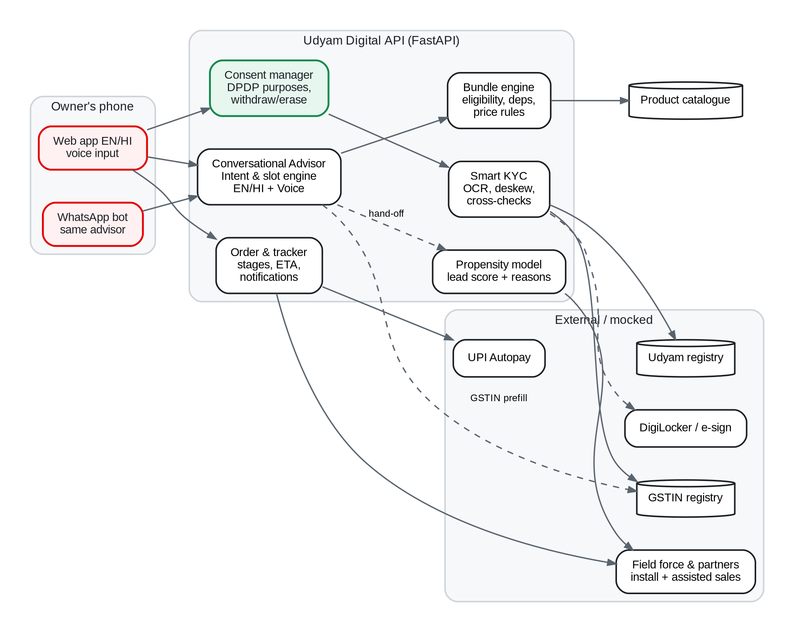

# Udyam Digital: small businesses go digital in one sitting

Prototype for **Airtel Sync 2026 · Digital Track** (case: *Project Udyam Digital*, fictional operator Accel Business).

A small-business owner opens a link on their phone and does four things without a sales visit:
1. **Advisor** (English/Hindi, with voice): answers about 6 questions and gets a bundle recommendation, with a plain-language reason for every product.
2. **Quote and checkout:** sees one monthly price, toggles add-ons and picks a 12- or 24-month plan. Dependencies and eligibility are enforced automatically.
3. **Smart KYC:** gives DPDP consent, uploads documents (or uses DigiLocker), and gets OCR, deskew and checks against the GSTIN and Udyam registries, with a pass/warn/fail result explained in plain words.
4. **Tracker:** follows the order stages with ETAs and WhatsApp updates, so there is no need to call support.

There is also a stretch-goal **back office**: leads the advisor couldn't close, ranked by a propensity model (5-fold CV AUC 0.71) with the reasons behind each score and a suggested route (digital nudge, field sales or partner).



## Submission Deliverables (Airtel SYNC 2026)

1. **Working Prototype:** Run with `./run.sh` (Customer: `http://localhost:8000`, Back Office: `http://localhost:8000/backoffice.html`).
2. **Official 7-Slide Submission Presentation:** [`docs/presentation_7_slides.md`](docs/presentation_7_slides.md)
3. **10-Slide Full Business Case:** [`docs/pitch_deck_10_slides.md`](docs/pitch_deck_10_slides.md)
4. **Solution Architecture & Data Flows:** [`docs/solution_architecture.md`](docs/solution_architecture.md) & [`docs/architecture.mmd`](docs/architecture.mmd)
5. **1-Page Data Privacy & Security Note (DPDP 2023):** [`docs/privacy_note.md`](docs/privacy_note.md)

---

## Run it (One-Click or Manual)

### Quickest (One-Click)
```bash
./run.sh
```
*This automatically activates `.venv` and starts Udyam Digital at `http://localhost:8000`.*

### Manual Terminal Setup
```bash
python3 -m venv .venv && source .venv/bin/activate      # Windows: .venv\Scripts\activate
pip install -r requirements.txt
python3 -m uvicorn backend.app:app --host 0.0.0.0 --port 8000 --reload
```
Open **http://localhost:8000** for the customer journey (use phone width, or DevTools device mode) and **http://localhost:8000/backoffice.html** for the executive back-office desk.

In VS Code, press **F5** and choose "Run Udyam Digital" (configured in `.vscode/launch.json`).

---

## Evaluation & Test Scripts (For Judges & Benchmark)

1. **Run 10 Live Benchmark MSME Scenarios:**
   ```bash
   ./scripts/test_advisor_scenarios.py
   ```
   *Runs micro retail, dental clinic, CA firm, ed-tech branch, multi-site restaurant chain, manufacturing plant, and low-spend kirana scenarios with instant deterministic pricing, setup fee waivers, and SLA install days.*

2. **Run Smart KYC Batch on All 12 Applicants:**
   ```bash
   .venv/bin/python3 scripts/run_kyc_batch.py
   ```
   *Runs OCR & cross-document validation on all 47 images (K01–K12) and checks against GST/Udyam registries.*

3. **Run Regression & End-to-End Test Suite:**
   ```bash
   .venv/bin/pytest tests/test_core.py -v
   ```
   *12 automated tests validating Mod-36 checksums, KYC error detection, advisor slot extraction, quote calculation, and consent erasure.*

**Conversational Advisor:** Ultra-fast (<5ms), privacy-preserving slot-filling engine with voice and text input (EN/HI/Hinglish). Extracts business type, size, sites, city/pincode, GSTIN, needs, and spend deterministically without external LLM API dependencies or hallucinations.

**Demo shortcuts:** on the KYC screen, "Demo: load a case applicant" runs the specimen documents K01–K12 through Smart KYC. The tracker has a "simulate next field update" button.

## What's where
| Path | What |
|---|---|
| `backend/advisor.py` | Conversational engine: multi-slot intent/entity extraction, tap chips, plain-language bundle explanation |
| `backend/catalogue.py` | Bundle engine: needs → products, eligibility (tier, employees, sites, GSTIN), dependencies, transparent pricing, micro affordability cap |
| `backend/kyc.py` | OCR pipeline (watermark removal, deskew, blur rescue), field extraction, GSTIN repair verified by the registry, cross-document checks |
| `backend/registry.py` | GSTIN checksum/format, Udyam format, mock registry lookups, masking |
| `backend/propensity.py` | Lead scoring (logistic regression, no-leakage features, explanations) |
| `backend/app.py` | FastAPI: consent, KYC, quote, order/tracker, back-office APIs, audit log |
| `frontend/` | Mobile web app (vanilla JS) and back office |
| `analysis/impact_model.py` | Funnel impact model behind the business case |
| `scripts/run_kyc_batch.py` | Runs Smart KYC on all 12 specimen applicants |
| `docs/privacy_note.md` | 1-page data privacy and security note |

## Smart KYC on the 12 specimen applicants
| Applicant | Result | What the system caught |
|---|---|---|
| K01 | Needs fix | GSTIN **Cancelled** in registry; Udyam number missing on certificate |
| K02 | Verified | Photo tilted 7°, auto-straightened |
| K03, K08, K10 | Verified | OCR confusions (O/0, I/J) repaired, confirmed by the registry |
| K04 | Needs fix | GST certificate photo **blurry**, GSTIN unreadable → retake prompt |
| K05 | Review | Udyam certificate not uploaded |
| K06 | Needs fix | GSTIN fails the checksum; registry has a 2-character-different GSTIN for this business (likely altered) |
| K07 | Needs fix | Legal name on certificate ("Shri Physio Clinic") ≠ GST registry ("Neelgiri Physio Clinic") |
| K09, K12 | Verified | – |
| K11 | Needs fix | Electricity bill **257 days old** (limit 90) |

Run `python scripts/run_kyc_batch.py` to reproduce. Tests: `pytest -q tests`.

All data is synthetic and was provided with the case.
